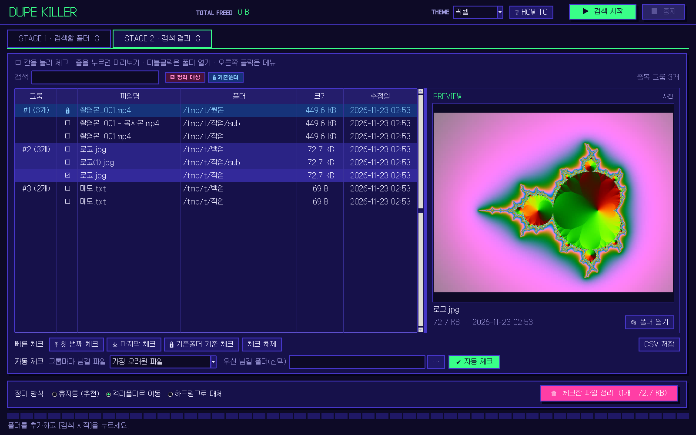

# DUPE KILLER — 중복파일 정리기

내용이 **100% 같은 파일**만 찾아서 안전하게 정리하는 Windows용 중복파일 정리기입니다. 파이썬과 tkinter로 만들었어요.

## 특징

- **정확한 비교**: 크기 → 앞부분 64KB → 파일 전체(SHA-256) 순서로 비교해요. 이름이 달라도 내용이 같으면 찾고, 1바이트라도 다르면 건드리지 않아요.
- **폴더 역할**
  - 일반: 검색 대상
  - 🔒기준: 원본 보관 폴더. 여기 있는 파일은 절대 지우지 않아요.
  - 제외: 검색에서 빼는 폴더
- **안전한 정리 방식**: 휴지통으로 이동, 격리폴더로 이동, 하드링크로 대체 중에서 고를 수 있어요.
- **안전장치**
  - 그룹마다 최소 1개는 남겨요.
  - 정리 직전에 파일이 바뀌지 않았는지 다시 확인해요.
  - 정리할 때마다 기록을 CSV로 저장해요.
- **편의 기능**
  - 폴더 끌어다 놓기
  - 사진·텍스트·영상 썸네일 미리보기
  - 오른쪽 클릭 메뉴
  - 자동 체크 (오래된 것 남기기, 복사본 지우기 등)
- **테마 3종**: 픽셀(기본), 미드나잇, 브루탈

## 실행 방법

1. [Python 3.8 이상](https://www.python.org)을 설치하세요. 설치할 때 **Add python.exe to PATH**를 체크하세요.
2. 이 저장소를 내려받으세요. **Code → Download ZIP** 후 압축을 풀면 돼요.
3. 실행하세요.
   - `실행.bat`을 더블클릭하거나
   - 터미널에서 `python 중복파일정리기.py`를 입력하세요.

사진·영상 미리보기를 쓰려면 Pillow가 필요해요. `실행.bat`이 처음 실행할 때 자동으로 설치해요.

## exe 만들기

- VS Code에서 `exe빌드.py`를 열고 ▶(Run)을 누르면 같은 폴더에 `중복파일정리기.exe`가 생겨요.
- `exe만들기.bat`을 더블클릭해도 돼요.

> **Windows 스마트 앱 컨트롤**이 켜져 있으면, 서명되지 않은 bat·exe 파일이 막힐 수 있어요. 그럴 때는 `python 중복파일정리기.py`로 실행하세요.

## 폰트 라이선스

`fonts` 폴더의 폰트는 모두 **SIL Open Font License 1.1**이에요.
- [갈무리(Galmuri)](https://github.com/quiple/galmuri)
- [원티드 산스(Wanted Sans)](https://github.com/wanteddev/wanted-sans)

라이선스 원문은 `fonts` 폴더 안에 있어요.

## 참고

DoubleKiller와 dupeGuru의 기능을 참고해서 새로 작성한 코드예요.
